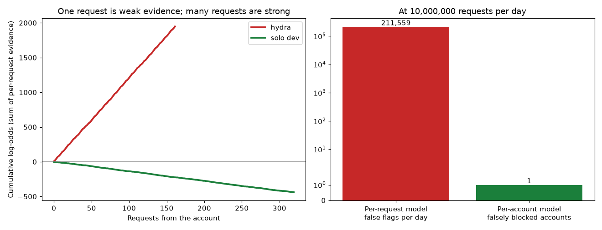
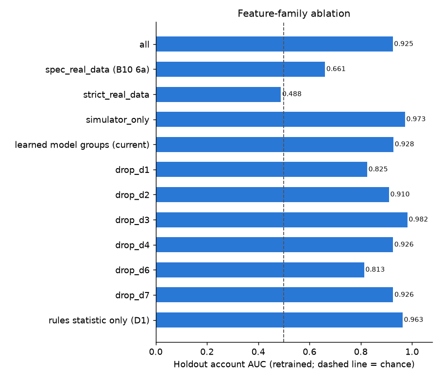

# Distillation Watchdog

## Purpose

The Distillation Watchdog finds accounts that use a model API to collect training data for another model ("distillation").
It examines the traffic of a coding-agent model API in a laboratory setup.
One request alone gives only a weak signal. The watchdog adds the signals for each account, and then it connects accounts into campaigns.
It blocks accounts, and it shows the evidence for each block.

The system has five processes on one computer:

| Process | Port | Function |
|---|---|---|
| Lab gateway | 8000 | An OpenAI-compatible model API. It replays recorded agent steps, or it calls the lab model on OpenRouter. It refuses blocked accounts with HTTP 403. |
| Normal traffic generator | 8001 | Sends the traffic of normal accounts: solo developers, a SaaS app, and benchmark runners. |
| Attack traffic generator | 8002 | Sends the traffic of distillation accounts: hydra, fake environment, and stealth. |
| Agent chat | 8003 | A small coding agent for a person. It uses the lab model through the gateway. |
| Watchdog | 8010 | Receives the request events, scores the accounts, finds campaigns, and serves the dashboard. |

## Architecture

```
  normal generator (8001) ──┐
  attack generator (8002) ──┼──► lab gateway (8000) ──► replay backend (recorded steps)
  agent chat       (8003) ──┘          │   ▲             live backend (OpenRouter, lab model)
                                       │   │
                     request events    │   │ block list (polled every second)
                     (POST /ingest)    ▼   │
                              watchdog (8010)
                              detectors ► rules score + learned model ► policy ► campaigns ► case files
                              dashboard: Live, Account, Campaigns, Evaluation        │
                                                                                   │ SSH tunnel (127.0.0.1:9100)
                                                          context model service on a GPU machine (D4 and D6 text)
```

- The generators send requests with a private `x_replay` field. The gateway removes this field before the watchdog gets the event. The watchdog never sees it.
- The detectors get a `DetectorView`. The view has no assistant text, no source, and no label.
- The generators and the replay backend never execute commands.
- Only the agent chat executes tool calls. It executes them in `agent_workspace/`. Each shell command needs an approval click from the person.

The detectors and how they decide:

| Detector | Signal | Used in |
|---|---|---|
| D1 redundancy | The same conversation state is sent many times (duplicates from the prefix hash chain). | **Rules score** |
| D2 engagement | Follow-up turns, corrections, and returns to the same repository. | Learned model |
| D3 coverage | The number of repositories and topics of the account. | Learned model |
| D4 elicitation | User prompts that ask for full reasoning and detail (context model), and request parameters (temperature, `max_tokens`, reasoning effort). | Learned model |
| D6 environment | Tool outputs that a model wrote instead of a real machine (context model). | Learned model |
| D7 volume | Request rate, active hours, concurrent sessions, and the `user` field. | Exoneration only |

The account state is the most severe of three levels:

1. The **rules score**: the share of requests that repeat an earlier context of the account (D1). Its block and review thresholds come from the validation split. D7 can only lower it: an account with many distinct `user` values or a declared use gets at most "review" from the rules.
2. The **learned model**: a logistic regression over D2, D3, D4, and D6. It is trained on feature snapshots taken at several request counts, because it decides on partial account histories.
3. The **campaign**: Louvain groups of linked accounts (shared tasks, synchronized activity, a shared rare tool format).

The **context model** is a fine-tuned small language model (Qwen3-0.6B-Base). It gives the text scores of D4 and D6. It runs on a GPU machine behind a scoring service, and the watchdog reaches it through an SSH tunnel. Scores are cached on disk. If the service does not answer, D4 and D6 leave the text features out, and the account model uses the training mean.

## Data and licences

| Dataset | Licence | Use |
|---|---|---|
| SWE-chat (`SALT-NLP/SWE-chat`, gated) | ODC-BY | Real coding-agent sessions of open-source developers. Normal personas, stealth persona. Timing fit. |
| Open-SWE-Traces (`nvidia/Open-SWE-Traces`) | CC BY 4.0 | Agent trajectories by NVIDIA. Attack personas, benchmark persona. The `sweagent` split is the cross-harness control. |

Attribution: NVIDIA made Open-SWE-Traces. This project uses it under the CC BY 4.0 licence.

Data rules:

- SWE-chat text never goes to OpenRouter. Only Open-SWE-Traces text, generated text, and the text of the person in the agent chat go to OpenRouter.
- The context model runs on a rented GPU machine (RunPod). Its training data and the texts that it scores include SWE-chat text. The project owner approved this exception. The connection is an SSH tunnel; the scoring service listens only on the GPU machine itself.
- The build hashes all SWE-chat user IDs with a salted SHA-256. The UI shows only pseudonyms (`acct-` and 6 hex characters).
- The build removes e-mail addresses, API keys, and home paths from all text.
- The repository does not contain raw data. `data/`, `cache/`, `models/`, and `.env` are in `.gitignore`.

## Setup

The system runs on Linux (tested on WSL with Ubuntu 24.04). It needs Python 3.12 and about 8 GB of disk. The context model needs a GPU machine with SSH access (tested on one A100 80 GB).

1. Install `uv`: `curl -LsSf https://astral.sh/uv/install.sh | sh`.
2. Make the environment: `uv venv .venv --python 3.12`.
3. Install the packages: `uv pip install -r requirements.txt && uv pip install -e .`.
4. Copy `.env.example` to `.env`. Write your keys in `.env` (see "Keys").
5. Get the data: `scripts/build_data.sh`. This downloads about 6.4 GB and makes the splits and the synthetic assets.
6. Train the context model on the GPU machine (see "Context model"). Start the tunnel: `scripts/context_tunnel.sh`.
7. Train the other models: `scripts/train.sh`.
8. Run the offline evaluation: `scripts/eval.sh`.
9. Run the tests: `.venv/bin/pytest -q` and `scripts/smoke.sh`. The tests use a stand-in for the context model and need no GPU.

### Context model

1. Build the training data: `.venv/bin/python -m dw.train.context_data`. This writes `data/context/`.
2. Copy `scripts/context_train.py`, `scripts/context_serve.py`, and `data/context/` to the GPU machine.
3. On the GPU machine, install `torch`, `transformers`, `fastapi`, `uvicorn`, and `scikit-learn`, then run `python context_train.py --data data --out out --max-len 768`.
4. Start the scoring service on the GPU machine: `python context_serve.py --model out/best`.
5. Copy `out/metrics.json` to `models/context_metrics.json` on this machine.

## Keys

| Variable | Use |
|---|---|
| `HF_TOKEN` | Download of the gated SWE-chat dataset. Accept the dataset terms on Hugging Face first. |
| `OPENROUTER_API_KEY` | The lab model (live backend and agent chat) and the helper model (synthetic assets). |
| `DW_POD_HOST`, `DW_POD_PORT` | The SSH address of the GPU machine for `scripts/context_tunnel.sh`. The key is `~/.ssh/dw_runpod`. |

CAUTION: Do not commit `.env`. The agent shell does not get these variables.

The build uses no `:free` model routes on OpenRouter. The build keeps all LLM calls in a cache in `cache/llm/`. The tests do not call OpenRouter.

## Run

- `scripts/context_tunnel.sh` opens the tunnel to the context model service. Start it before the other processes.
- `scripts/demo.sh` starts the five processes in a `tmux` session `dw`. If `tmux` is not installed, it starts them in the background with logs in `logs/`.
- `scripts/stop.sh` stops all processes.
- `scripts/smoke.sh` runs the end-to-end test. It uses a recorded model response and does not call OpenRouter.

## Demo

1. Run `scripts/demo.sh`. Attach with `tmux attach -t dw`. The session has five panes: lab, watchdog, agent chat, normal generator, attack generator.
2. Open the dashboard at `http://127.0.0.1:8010`. Open the agent chat at `http://127.0.0.1:8003`.
3. In the normal generator pane (or at `http://127.0.0.1:8001`), start Solo developers, SaaS app, and Benchmark runner. The dashboard stays mostly green. SaaS and Benchmark show some flags but no blocks.
4. In the agent chat, ask the agent to write a small function and its test in the sandbox. Approve the test run. The "you" account stays normal on the dashboard.
5. In the attack generator pane (or at `http://127.0.0.1:8002`), start Hydra. The account scores increase. A campaign forms in the graph. Blocks start. The attack pane shows 403 responses, and the leaked-trajectory count stops for the blocked accounts. At the demo speed, the Hydra scenario ends in a short time.
6. Start Stealth. The account score blocks many stealth accounts. The others stay below the account threshold. The campaign link does not catch them (see "Limits").
7. Open one evidence item: for example, a duplicate state sent 8 times, or a tool output that the context model scores as model-written.
8. Click "Generate case file". Each claim in the case file cites evidence.
9. Open the Evaluation tab: per-request versus per-account, leakage controls, and compute cost.

## Results

All numbers in this section come from `reports/`. `python -m dw.eval.readme` writes this section again from the reports.

<!-- RESULTS:START -->
Holdout scenario: 45,830 requests, 359 accounts, 350 accounts with enough requests to score (scale `full`, seed 301).

### Per-request versus per-account

| Measure | Value |
|---|---|
| Per-request model AUC | 0.929 |
| Per-request threshold (from validation) | 0.527 |
| Per-request false positive rate at this threshold | 0.021 |
| Per-request recall at this threshold | 0.700 |
| False request flags per day at 10,000,000 requests | 211,559 |
| Learned model AUC (account level) | 0.934 |
| Rules statistic AUC (D1 repeated contexts) | 0.963 |
| Normal accounts in the holdout | 64 |
| Falsely blocked normal accounts | 1 |
| Attack accounts blocked (share) | 0.944 |



### Accounts per persona

"Rules" is the D1 rules score. "Model" is the learned model. "Account level" is either one. "Final" includes the campaign propagation.

| Persona | Accounts | Blocked (rules) | Blocked (model) | Blocked (account level) | Blocked (final) | Review or block (final) |
|---|---|---|---|---|---|---|
| Solo developer | 53 | 1 | 0 | 1 | 1 | 2 |
| SaaS app | 1 | 0 | 0 | 0 | 0 | 0 |
| Benchmark runner | 10 | 0 | 0 | 0 | 0 | 0 |
| Hydra | 200 | 200 | 113 | 200 | 200 | 200 |
| Fake environment | 47 | 47 | 22 | 47 | 47 | 47 |
| Stealth | 39 | 7 | 16 | 23 | 23 | 26 |


### Time to block and leakage

| Persona | Accounts | Blocked | Median requests to block | Median simulated minutes to block |
|---|---|---|---|---|
| Hydra | 200 | 200 | 37 | 0.400 |
| Fake environment | 48 | 47 | 34 | 1.100 |
| Stealth | 40 | 23 | 46 | 223.4 |

| Persona | Complete trajectories served | Complete trajectories tried |
|---|---|---|
| Benchmark runner | 304 | 304 |
| Fake environment | 7 | 7 |
| SaaS app | 74 | 74 |
| Solo developer | 86 | 86 |
| Stealth | 65 | 67 |

Campaign effect on stealth: account-level recall 0.590, recall after campaigns 0.590, 7 campaigns found.

### D4 elicitation on bank B (phrases not seen in training)

| Model | Precision | Recall | False positive rate |
|---|---|---|---|
| Context model | 0.990 | 0.899 | 0.009 |
| Keyword baseline | 0.549 | 0.271 | 0.223 |

### D6 environment (context model)

| Group | Mean realism score | Share of tool outputs with a score of 0.5 or more |
|---|---|---|
| Fake-environment accounts | 0.382 | 0.375 |
| Other accounts | 0.089 | 0.075 |

On the holdout realism set (6,918 tool outputs, fakes against real Open-SWE outputs), the context model has AUC 0.943, recall 0.777, and a false positive rate of 0.049 at the score 0.5.

It flags 0.198 of 3,000 real SWE-chat tool outputs in the holdout (a source that it did not see in training).


### Compute

| Measure | Value |
|---|---|
| Training, wall time (s) | 123.7 |
| Training, CPU time (s) | 225.4 |
| Evaluation, wall time (s) | 773.4 |
| Evaluation, requests per second | 59.300 |
| Lab gateway load test, requests per second | 709.9 |
| Lab gateway `handle()` p95 (ms) | 0.841 |
| OpenRouter cost, total (USD) | 2.370 |
<!-- RESULTS:END -->

## Leakage controls

<!-- CONTROLS:START -->
| Control | Result | Target | Status |
|---|---|---|---|
| 1. Scaffold denylist | 0 dirty records | 0 | pass |
| 2. Format probe (source from formatting) | AUC 0.999 | below 0.7 | fail |
| 3. Assistant-prose probe (source from prose) | AUC 0.999 | high (expected) | info |
| 4. Cross-harness (hydra on SWE-agent data) | hydra recall 1 (normal), 1 (other harness) | same recall | pass |
| 4a. Cross-harness, same sessions per account (fewer SWE-agent accounts) | hydra recall 1 (main, 200 accounts), 1 (other harness, 27 accounts) | same recall | pass |
| 4b. Cross-harness, same sessions per account (main data, small task pool) | hydra recall 1 (main, 82 accounts), 1 (other harness, 82 accounts) | same recall | pass |
| 5. Label permutation | mean AUC 0.569 (std 0.207), p = 0.048 | near 0.5 | see note |
| 7. Source reliance (score against data source, same label) | normal accounts: AUC 0.531 (Open-SWE 10 accounts, 0 blocked; SWE-chat 54 accounts, 1 blocked); stealth: Spearman 0.076 (p = 0.647) | AUC near 0.5, correlation near 0 | info |

6. Feature-family ablation (fit on train, thresholds on validation, results on holdout):

| Feature set | Features | Holdout AUC | Recall at block | False positive rate at block |
|---|---|---|---|---|
| all | 30 | 0.925 | 0.626 | 0.000 |
| spec_real_data (B10 6a) | 14 | 0.661 | 0.007 | 0.000 |
| strict_real_data | 11 | 0.488 | 0.000 | 0.000 |
| simulator_only | 14 | 0.973 | 0.874 | 0.000 |
| learned model groups (current) | 7 | 0.928 | 0.535 | 0.000 |
| drop_d1 | 24 | 0.825 | 0.549 | 0.000 |
| drop_d2 | 25 | 0.910 | 0.745 | 0.031 |
| drop_d3 | 26 | 0.982 | 0.909 | 0.000 |
| drop_d4 | 23 | 0.926 | 0.755 | 0.016 |
| drop_d6 | 28 | 0.813 | 0.549 | 0.047 |
| drop_d7 | 24 | 0.926 | 0.657 | 0.000 |
| rules statistic only (D1) | 1 | 0.963 | 0.888 | 0.016 |



Largest format-probe features: `user_md_heading`, `user_blank_runs`, `user_inline_code`, `user_count_log`, `tool_count_log`, `user_char_punct`.
<!-- CONTROLS:END -->

## Which signals are real and which are simulated

| Signal | Origin |
|---|---|
| Message text, tool calls, and tool outputs (D2, D3, D4 text, D6) | Real recorded sessions (SWE-chat and Open-SWE-Traces). |
| Fake tool outputs (fake-environment persona) and elicitation banks | Generated by the helper model. |
| Normal timing (think time, step gaps, session length) | Fitted from real SWE-chat timestamps. |
| Account structure (accounts per persona, sessions per account, duplicates sent by hydra) | Simulated. |
| Attack timing, request rate, and concurrency (D7) | Simulated. |
| Request parameters (temperature, `n`, `max_tokens`, reasoning effort) | Simulated. |

The feature-family ablation in "Leakage controls" shows the result with and without the simulated features.

## Limits

- The account structure and the timing of attackers are simulated. The normal timing parameters are fitted from real SWE-chat data. All personas use the same simulator.
- In replay mode, the assistant does not react to fake tool outputs. The model of a real attacker would react.
- SWE-chat users are open-source developers who agreed to share their sessions. They do not represent all users.
- The two data sources come from different agent harnesses. The benchmark persona (normal) and the stealth persona (attack) mix the sources, and the controls measure the remaining source signal.
- A shell command in the agent chat can read files outside `agent_workspace/` (for example `../.env`). Only the approval click prevents this.
- The simulation clock runs faster than real time (`sim.speed` in `config.yaml`). A real deployment uses server time.
- Training: BUILD.md B9 sets a limit of 10 CPU minutes. A first run computes the text embeddings, and it uses more than this limit. A later run uses the embedding cache in `cache/emb/` and stays below the limit (see "Compute" in "Results"). The CPU time does not include the context model: its fine-tuning and its scores run on the GPU machine.
- Format probe (control 2) fails. Formatting features predict the data source. The largest features are markdown in user text and the session shape (number of user turns and tool results). Open-SWE prompts are GitHub issue texts, and SWE-chat prompts are chat messages. More scaffold stripping cannot remove this difference. Protections: the training scenarios contain normal accounts on Open-SWE data (benchmark runners) and attack accounts with SWE-chat sessions and follow-up turns (stealth). Control 7 checks whether the account score follows the data source when the label is the same.
- Path strings (for example `/home/` and `/workspace`) and the name of the agent harness in the text also show the source. A fix needs a new data build.
- Cross-harness control (control 4): the rules score catches hydra on both harnesses, because the duplicate rate does not depend on the harness. Controls 4a and 4b give both sides the same number of sessions per account. Control 4a has few accounts, so its recall changes by large steps.
- Stealth accounts work on their own tasks. They share no task, prompt, timing, or file set with other accounts, so the campaign propagation adds little for them. Only the account score finds them.
- The training, validation, and holdout scenarios use the same stealth design with different sessions. Thus the stealth result does not show the recall for an attacker design that the model did not see in training.
- Most of the detection power comes from signals that the simulator defines (feature-family ablation). The rules score uses the duplicate rate, and best-of-n copies are a persona parameter. The learned model uses D4: elicitation phrases from the LLM-written banks, and request settings from the simulator. The features from real data alone do not separate the classes. These signals are assumptions about attacker behavior.
- D2 (engagement), D3 (coverage), and D6 (environment) do not score. On the validation split they added no recall and made the score follow the data source. D6 runs and gives evidence. Its context model saw fake tool outputs only for Open-SWE contexts, so it gives real SWE-chat outputs high scores (see "D6 environment" in "Results"). A fix needs fake outputs for SWE-chat contexts.
- The context model runs on a rented GPU machine. Without it, D4 has no text score, and the learned model can only flag an account for review. The rules score and the campaigns still block.
- The account model blocks some normal solo-developer accounts (see "Accounts per persona"). A real deployment needs a human review and an appeal process before a block.
- The holdout has few normal accounts. Thus one falsely blocked account changes the false positive rate by a large step.

## Future work

- Sandbox re-execution: execute the tool calls of a suspicious session again in a sandbox and compare the outputs.
- Server time instead of simulation time.
- A React front end (see `docs/REACT_STAGE.md`).
- Deployment on more than one machine (a queue between the gateway and the watchdog, and shared state for the worker).
