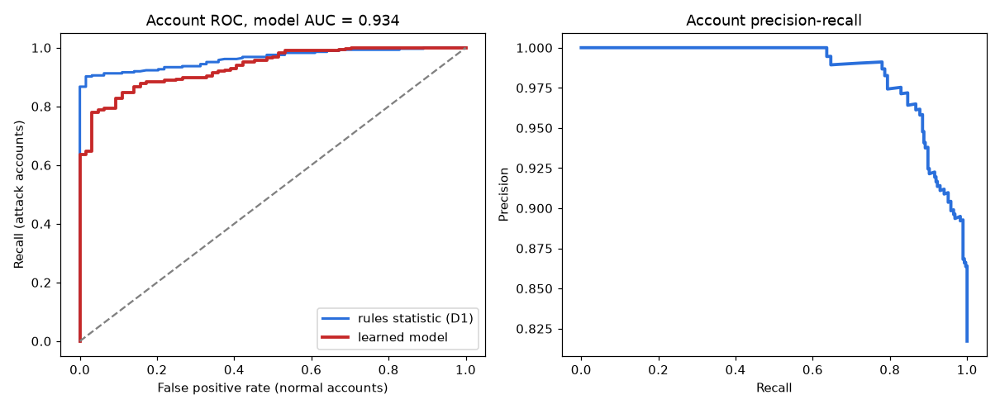

# Distillation Watchdog

## Purpose

The Distillation Watchdog finds accounts that use a model API to collect training data for another model ("distillation").
It examines the traffic of a coding-agent model API in a laboratory setup.
One request alone gives only a weak signal. The watchdog adds the signals for each account, and then it connects accounts into campaigns.
It blocks accounts, and it shows the evidence for each block.

The system has five processes on one computer:

| Process | Port | Function |
|---|---|---|
| Lab gateway | 8000 | An OpenAI-compatible model API. It replays recorded agent steps, or it calls the lab model on OpenRouter. It refuses blocked accounts with HTTP 403. |
| Normal traffic generator | 8001 | Sends the traffic of normal accounts: solo developers, a SaaS app, and benchmark runners. |
| Attack traffic generator | 8002 | Sends the traffic of distillation accounts: hydra, fake environment, and stealth. |
| Agent chat | 8003 | A small coding agent for a person. It uses the lab model through the gateway. |
| Watchdog | 8010 | Receives the request events, scores the accounts, finds campaigns, and serves the dashboard. |

## Architecture

```
  normal generator (8001) ──┐
  attack generator (8002) ──┼──► lab gateway (8000) ──► replay backend (recorded steps)
  agent chat       (8003) ──┘          │   ▲             live backend (OpenRouter, lab model)
                                       │   │
                     request events    │   │ block list (polled every second)
                     (POST /ingest)    ▼   │
                              watchdog (8010)
                              detectors D1–D7 ► account model ► policy ► campaigns ► case files
                              dashboard: Live, Account, Campaigns, Evaluation
```

- The generators send requests with a private `x_replay` field. The gateway removes this field before the watchdog gets the event. The watchdog never sees it.
- The detectors get a `DetectorView`. The view has no assistant text, no source, and no label.
- The generators and the replay backend never execute commands.
- Only the agent chat executes tool calls. It executes them in `agent_workspace/`. Each shell command needs an approval click from the person.

The detectors:

| Detector | Signal |
|---|---|
| D1 redundancy | The same conversation state is sent many times (duplicates and branches from the prefix hash chain). |
| D2 engagement | The account does not read the answer: no follow-up, no correction, no return to the same repository. |
| D3 coverage | The account covers many repositories and topics instead of focusing on one project. |
| D4 elicitation | The prompts ask for reasoning and full explanations. Request parameters (temperature, `n`, `max_tokens`, reasoning effort). |
| D5 templates | The first prompts come from a small number of templates. |
| D6 environment | The tool outputs contradict each other (shadow file system), or they look written by a model (realism classifier). |
| D7 volume | Request rate, active hours, concurrent sessions, and the `user` field. |

## Data and licences

| Dataset | Licence | Use |
|---|---|---|
| SWE-chat (`SALT-NLP/SWE-chat`, gated) | ODC-BY | Real coding-agent sessions of open-source developers. Normal personas, stealth persona. Timing fit. |
| Open-SWE-Traces (`nvidia/Open-SWE-Traces`) | CC BY 4.0 | Agent trajectories by NVIDIA. Attack personas, benchmark persona. The `sweagent` split is the cross-harness control. |

Attribution: NVIDIA made Open-SWE-Traces. This project uses it under the CC BY 4.0 licence.

Data rules:

- SWE-chat text never goes to an external API. Only Open-SWE-Traces text, generated text, and the text of the person in the agent chat go to OpenRouter.
- The build hashes all SWE-chat user IDs with a salted SHA-256. The UI shows only pseudonyms (`acct-` and 6 hex characters).
- The build removes e-mail addresses, API keys, and home paths from all text.
- The repository does not contain raw data. `data/`, `cache/`, `models/`, and `.env` are in `.gitignore`.

## Setup

The system runs on Linux (tested on WSL with Ubuntu 24.04). It needs Python 3.12, about 8 GB of disk, and no GPU.

1. Install `uv`: `curl -LsSf https://astral.sh/uv/install.sh | sh`.
2. Make the environment: `uv venv .venv --python 3.12`.
3. Install the packages: `uv pip install -r requirements.txt && uv pip install -e .`.
4. Copy `.env.example` to `.env`. Write your keys in `.env` (see "Keys").
5. Get the data: `scripts/build_data.sh`. This downloads about 6.4 GB and makes the splits and the synthetic assets.
6. Train the models: `scripts/train.sh`.
7. Run the offline evaluation: `scripts/eval.sh`.
8. Run the tests: `.venv/bin/pytest -q` and `scripts/smoke.sh`.

## Keys

| Variable | Use |
|---|---|
| `HF_TOKEN` | Download of the gated SWE-chat dataset. Accept the dataset terms on Hugging Face first. |
| `OPENROUTER_API_KEY` | The lab model (live backend and agent chat) and the helper model (synthetic assets). |

CAUTION: Do not commit `.env`. The agent shell does not get these variables.

The build uses no `:free` model routes on OpenRouter. The build keeps all LLM calls in a cache in `cache/llm/`. The tests do not call OpenRouter.

## Run

- `scripts/demo.sh` starts the five processes in a `tmux` session `dw`. If `tmux` is not installed, it starts them in the background with logs in `logs/`.
- `scripts/stop.sh` stops all processes.
- `scripts/smoke.sh` runs the end-to-end test. It uses a recorded model response and does not call OpenRouter.

## Demo

1. Run `scripts/demo.sh`. Attach with `tmux attach -t dw`. The session has five panes: lab, watchdog, agent chat, normal generator, attack generator.
2. Open the dashboard at `http://127.0.0.1:8010`. Open the agent chat at `http://127.0.0.1:8003`.
3. In the normal generator pane (or at `http://127.0.0.1:8001`), start Solo developers, SaaS app, and Benchmark runner. The dashboard stays mostly green. SaaS and Benchmark show some flags but no blocks.
4. In the agent chat, ask the agent to write a small function and its test in the sandbox. Approve the test run. The "you" account stays normal on the dashboard.
5. In the attack generator pane (or at `http://127.0.0.1:8002`), start Hydra. The account scores increase. A campaign forms in the graph. Blocks start. The attack pane shows 403 responses, and the leaked-trajectory count stops for the blocked accounts. At the demo speed, the Hydra scenario ends in a short time.
6. Start Stealth. Most stealth accounts stay below the account threshold. The account score blocks some of them. The campaign link does not catch the others (see "Limits").
7. Open one evidence item: for example, a duplicate state sent 8 times, or a contradiction in the shadow file system.
8. Click "Generate case file". Each claim in the case file cites evidence.
9. Open the Evaluation tab: per-request versus per-account, leakage controls, and compute cost.

## Results

All numbers in this section come from `reports/`. `python -m dw.eval.readme` writes this section again from the reports.

<!-- RESULTS:START -->
Holdout scenario: 50,767 requests, 352 accounts, 343 accounts with enough requests to score (scale `full`, seed 301).

### Per-request versus per-account

| Measure | Value |
|---|---|
| Per-request model AUC | 0.909 |
| Per-request threshold (from validation) | 0.629 |
| Per-request false positive rate at this threshold | 0.097 |
| Per-request recall at this threshold | 0.775 |
| False request flags per day at 10,000,000 requests | 973,937 |
| Account model AUC | 0.957 |
| Normal accounts in the holdout | 57 |
| Falsely blocked normal accounts | 2 |
| Attack accounts blocked (share) | 0.892 |


### Accounts per persona

"Account level" uses only the account score. "Final" includes the campaign propagation.

| Persona | Accounts | Blocked (account level) | Blocked (final) | Review or block (final) |
|---|---|---|---|---|
| Solo developer | 53 | 2 | 2 | 4 |
| SaaS app | 1 | 0 | 0 | 0 |
| Benchmark runner | 3 | 0 | 0 | 0 |
| Hydra | 200 | 138 | 200 | 200 |
| Fake environment | 47 | 31 | 47 | 47 |
| Stealth | 39 | 8 | 8 | 11 |



### Time to block and leakage

| Persona | Accounts | Blocked | Median requests to block | Median simulated minutes to block |
|---|---|---|---|---|
| Hydra | 200 | 200 | 73 | 2.800 |
| Fake environment | 48 | 47 | 38 | 2.100 |
| Stealth | 40 | 8 | 58 | 193.3 |

| Persona | Complete trajectories served | Complete trajectories tried |
|---|---|---|
| Benchmark runner | 89 | 89 |
| Fake environment | 29 | 29 |
| Hydra | 284 | 286 |
| SaaS app | 74 | 74 |
| Solo developer | 86 | 86 |
| Stealth | 97 | 99 |

Campaign effect on stealth: account-level recall 0.205, recall after campaigns 0.205, 2 campaigns found.

### D4 elicitation on bank B (phrases not seen in training)

| Model | Precision | Recall | False positive rate |
|---|---|---|---|
| Classifier | 0.851 | 0.696 | 0.122 |
| Keyword baseline | 0.553 | 0.296 | 0.239 |

### D6 environment

| Group | Contradictions per 100 tool results | Sessions with a contradiction | Mean realism score |
|---|---|---|---|
| Fake-environment accounts | 0.146 | 0.032 | 0.452 |
| Other accounts | 0.058 | 0.009 | 0.316 |

The realism classifier flags 0.046 of 3,000 real SWE-chat tool outputs in the holdout.

### Compute

| Measure | Value |
|---|---|
| Training, wall time (s) | 681.6 |
| Training, CPU time (s) | 1,994.4 |
| Evaluation, wall time (s) | 56.800 |
| Evaluation, requests per second | 893.1 |
| Lab gateway load test, requests per second | 709.9 |
| Lab gateway `handle()` p95 (ms) | 0.841 |
| OpenRouter cost, total (USD) | 2.370 |
<!-- RESULTS:END -->

## Leakage controls

<!-- CONTROLS:START -->
| Control | Result | Target | Status |
|---|---|---|---|
| 1. Scaffold denylist | 0 dirty records | 0 | pass |
| 2. Format probe (source from formatting) | AUC 0.999 | below 0.7 | fail |
| 3. Assistant-prose probe (source from prose) | AUC 0.999 | high (expected) | info |
| 4. Cross-harness (hydra on SWE-agent data) | hydra recall 0.690 (normal), 0.561 (other harness) | same recall | fail |
| 5. Label permutation | mean AUC 0.462 (std 0.265), p = 0.048 | near 0.5 | see note |

6. Feature-family ablation (fit on train, thresholds on validation, results on holdout):

| Feature set | Features | Holdout AUC | Recall at block | False positive rate at block |
|---|---|---|---|---|
| all | 34 | 0.957 | 0.619 | 0.035 |
| spec_real_data (B10 6a) | 18 | 0.923 | 0.420 | 0.035 |
| strict_real_data | 11 | 0.801 | 0.297 | 0.053 |
| simulator_only | 14 | 0.954 | 0.832 | 0.000 |
| drop_d1 | 28 | 0.950 | 0.350 | 0.035 |
| drop_d2 | 29 | 0.958 | 0.759 | 0.088 |
| drop_d3 | 30 | 0.962 | 0.601 | 0.000 |
| drop_d4 | 27 | 0.956 | 0.836 | 0.035 |
| drop_d5 | 31 | 0.957 | 0.892 | 0.035 |
| drop_d6 | 31 | 0.917 | 0.266 | 0.000 |
| drop_d7 | 28 | 0.958 | 0.640 | 0.035 |


Largest format-probe features: `user_md_heading`, `user_blank_runs`, `user_inline_code`, `user_count_log`, `tool_count_log`, `user_char_punct`.
<!-- CONTROLS:END -->

## Which signals are real and which are simulated

| Signal | Origin |
|---|---|
| Message text, tool calls, and tool outputs (D1 branches, D2, D3, D4 text, D5, D6) | Real recorded sessions (SWE-chat and Open-SWE-Traces). |
| Fake tool outputs (fake-environment persona) and elicitation banks | Generated by the helper model. |
| Normal timing (think time, step gaps, session length) | Fitted from real SWE-chat timestamps. |
| Account structure (accounts per persona, sessions per account, duplicates sent by hydra) | Simulated. |
| Attack timing, request rate, and concurrency (D7) | Simulated. |
| Request parameters (temperature, `n`, `max_tokens`, reasoning effort) | Simulated. |

The feature-family ablation in "Leakage controls" shows the result with and without the simulated features.

## Limits

- The account structure and the timing of attackers are simulated. The normal timing parameters are fitted from real SWE-chat data. All personas use the same simulator.
- In replay mode, the assistant does not react to fake tool outputs. The model of a real attacker would react.
- SWE-chat users are open-source developers who agreed to share their sessions. They do not represent all users.
- The two data sources come from different agent harnesses. The benchmark persona (normal) and the stealth persona (attack) mix the sources, and the controls measure the remaining source signal.
- A shell command in the agent chat can read files outside `agent_workspace/` (for example `../.env`). Only the approval click prevents this.
- The simulation clock runs faster than real time (`sim.speed` in `config.yaml`). A real deployment uses server time.
- Training: BUILD.md B9 sets a limit of 10 CPU minutes. A first run computes the text embeddings, and it uses more than this limit (see "Compute" in "Results"). A later run uses the embedding cache in `cache/emb/` and stays below the limit.
- Format probe (control 2) fails. Formatting features predict the data source. The largest features are markdown in user text and the session shape (number of user turns and tool results). Open-SWE prompts are GitHub issue texts, and SWE-chat prompts are chat messages. More scaffold stripping cannot remove this difference.
- Path strings (for example `/home/` and `/workspace`) and the name of the agent harness in the text also show the source. A fix needs a new data build.
- Cross-harness control (control 4) fails. Hydra recall on SWE-agent data is lower than on the main data. The SWE-agent slice is small, so its hydra accounts get fewer sessions. Many of them have only one session. With one session, the repository and topic entropy (D3) is zero. Thus the control measures the size of the data slice more than the harness.
- In the holdout, the campaign propagation does not increase the stealth recall. Most stealth accounts stay below the block threshold.
- The training scenarios use a light stealth persona with one user turn per session. Thus the engagement features (D2) have a large weight. The holdout stealth persona adds follow-up turns.
- The holdout has few normal accounts. Thus one falsely blocked account changes the false positive rate by a large step.

## Future work

- Sandbox re-execution: execute the tool calls of a suspicious session again in a sandbox and compare the outputs.
- Server time instead of simulation time.
- A React front end (see `docs/REACT_STAGE.md`).
- Deployment on more than one machine (a queue between the gateway and the watchdog, and shared state for the worker).
